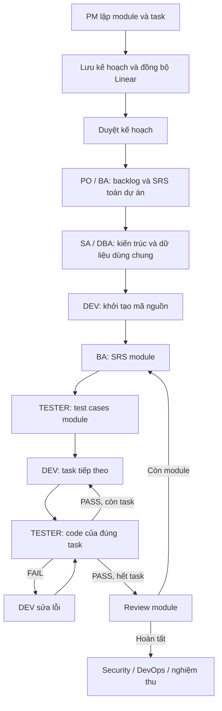

# Điều phối dự án theo module và task

Sau khi hoàn thành, dùng [luồng yêu cầu thay đổi](CHANGE_REQUESTS.md) để chỉnh sửa từ phiên bản đã bàn giao và giữ nguyên lịch sử.

PM lập toàn bộ backlog trước khi thực thi. Kế hoạch gồm dự án, các module theo thứ tự, công việc nghiệp vụ và tiêu chí nghiệm thu. Control Node chuyển kế hoạch thành các task theo vai trò, lưu vào MySQL và tạo Project, Milestone, Issue cùng quan hệ phụ thuộc trên Linear. Chỉ giao việc khi toàn bộ backlog đã đồng bộ thành công.

Luồng thực thi:



SRS toàn dự án được gửi cùng SRS module cho các task cần yêu cầu. SRS module được tạo một lần và dùng lại trong module đó. Mã nguồn trả về từ DEV phải là toàn bộ dự án đã tích hợp các task trước. Mỗi lần kiểm thử gắn với task tạo ra code, không chọn tùy ý bản code mới nhất. Khi sửa lỗi, các task phía sau chuyển sang dùng code đã sửa và chờ kết quả kiểm thử lại.

## Cấu hình và chạy

1. Khởi tạo MySQL/Redis và danh bạ agent theo `docs/RUNBOOK.md`. Các máy có mã nguồn agent thật và môi trường Python chứa các thư viện của agent đó.
2. Trong `control/.env`, cấu hình `LLM_API_KEY`, `LLM_PROVIDER`, `LLM_MODEL` để PM tự phân chia module. Với Linear thật, đặt `LINEAR_DRY_RUN=false`, `LINEAR_API_KEY`, `LINEAR_TEAM_ID`, và kiểm tra ánh xạ trạng thái/nhãn trong `control/linear.yaml`. `LINEAR_DRY_RUN=true` dùng bộ mô phỏng trong bộ nhớ, không tạo dữ liệu trên tài khoản Linear.
3. Đặt `CONTROL_PUBLIC_URL=http://<IP-PC1-trong-LAN>:8000` để Worker tải file và gửi callback đúng máy; không dùng `0.0.0.0` làm địa chỉ callback. `PROJECT_COORDINATOR_ENABLED=true` (mặc định) bật tiến trình điều phối khi Control Node khởi động. `PROJECT_POLL_SECONDS=2` là khoảng nghỉ giữa các chu kỳ. Chạy Control Node từ thư mục gốc `AGENT` như trước: `python scripts/start_control.py`.
4. Bổ sung `worker-pc1` từ `control/workers.example.yaml` vào `control/workers.yaml`. Sao chép `worker/worker.pc1.yaml.example` thành cấu hình PC1, thay secret tương ứng và chạy `python scripts/start_worker.py --config worker/worker.pc1.yaml`. Các Worker PC2..PC5 cũng phải chạy và đăng ký đúng agent/máy.
5. Worker mặc định dùng `runner: process`: chạy `cli.py run <task.json>` trong thư mục `path` của từng agent. Mỗi lần chạy có tiến trình riêng để tránh trùng module Python giữa các agent. Thư mục phải chứa agent thật; không còn tự thay bằng FakeAgent khi thiếu mã nguồn. Muốn mô phỏng phải đặt rõ `runner: fake` trong cấu hình agent.
6. Trong `agents/pm/.env`, đặt `PM_PROJECT_MODE=managed`, `CONTROL_URL=http://127.0.0.1:8000`, `CONTROL_ADMIN_TOKEN` bằng `ADMIN_TOKEN` của Control Node. PM API và CLI sẽ dùng chung vòng đời dự án tại Control Node. Không thay đổi các file `.env` đang có khi cập nhật mã nguồn.

`APPROVAL_MODE=true` giữ bước duyệt kế hoạch hiện có. Có thể duyệt từ issue `APPROVE_PLAN` trên Linear bằng `/approve`, hoặc qua API. Các cổng duyệt phạm vi và phát hành vẫn hoạt động. Nếu PM không lập được kế hoạch, hệ thống tạo một module dự phòng chứa toàn bộ yêu cầu, ghi `planning_warning` và bắt buộc chờ xem xét thay vì âm thầm bỏ bớt phạm vi.

## Tạo dự án

Qua Control Node, gửi `POST /api/v1/runs` với header `Authorization: Bearer <ADMIN_TOKEN>`:

```json
{
  "brief": "Xây dựng hệ thống thư viện có quản lý sách, tìm kiếm và mượn trả"
}
```

PM sẽ tự đề xuất module/task. Muốn chỉ định backlog, gửi thêm `module_plan` theo cấu trúc trong `agents/pm/examples/library_module_plan.json`. Kế hoạch được kiểm định đầy đủ trước khi lưu và đồng bộ.

Qua PM CLI, từ thư mục `agents/pm`:

```powershell
python cli.py project start --brief-file brief.md
# Hoặc cung cấp sẵn module/task:
python cli.py project start --brief-file brief.md --module-plan examples/library_module_plan.json
python cli.py project status RUN-... --watch
python cli.py project approve RUN-... --gate APPROVE_PLAN
```

Qua PM API, `POST /projects` nhận `brief` và tùy chọn `module_plan`; trả về `run_id`. Dùng chính **run_id** trong các đường dẫn status, approve, resume và abort của chế độ managed. Các cờ `auto_approve`/`allow_real_deploy` của Conductor cũ không điều khiển dự án managed; CLI từ chối các cờ đó, việc duyệt/triển khai dùng cấu hình Control Node.

Đọc `GET /api/v1/runs/{run_id}/plan`, `/tasks`, `/artifacts` để xem kế hoạch, nguồn tài liệu từng task và sản phẩm. `/tasks` có `module_id`, `work_item_id`, `title`, `input_artifact_sources`. Tiến độ, task và nguồn artifact nằm trong MySQL, nên việc tạo lại coordinator không làm chạy lại task đã hoàn thành. Worker lưu kết quả vào SQLite outbox trước khi gửi callback.

Giới hạn tổng task gồm cả BA, test, review và sửa lỗi là `MAX_TASKS_PER_RUN` (mặc định 60); không cắt bớt module/task cho vừa giới hạn. Giới hạn sửa lỗi là `MAX_FIX_LOOPS` (mặc định 3). Cần tăng giới hạn issue trong `control/linear.yaml` nếu backlog lớn; khi Linear chưa tạo đủ issue thì chưa giao việc.

`PM_PROJECT_MODE=legacy` chỉ dành cho tiếp tục các dự án Conductor cũ đã lưu trong `agents/pm/data`; luồng đó không sử dụng cơ chế backlog/module mới.

## Kiểm thử

Bước tổng kết cuối tự tạo [báo cáo toàn dự án dạng Word](PROJECT_REPORT.md), gắn vào sản phẩm của PM và lưu cùng release trước khi chuyển run sang `COMPLETED`.

```powershell
$env:PYTHONPATH="contract;."
python -m pytest control/tests/test_module_projects.py worker/tests/test_process_agent.py -q
```

Bộ kiểm thử dùng SQLite và FakeWorkTracker để kiểm tra thứ tự module/task, chặn khi Linear lỗi, bàn giao đúng SRS/code, sửa và kiểm thử lại, giới hạn sửa lỗi, khôi phục coordinator và chạy PM qua tiến trình thật. Không cần tài khoản Linear hoặc LLM cho các kiểm thử này.
