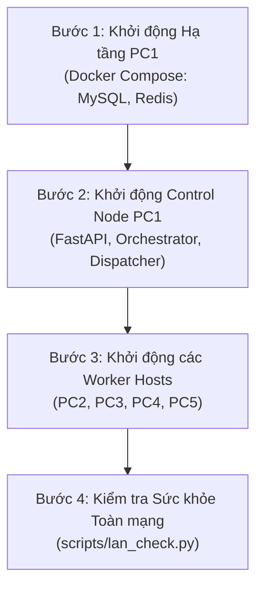
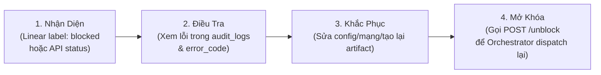
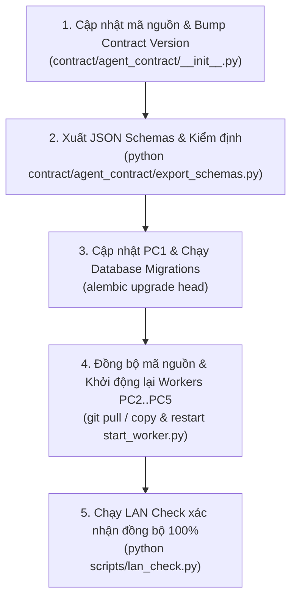

# Sổ tay Vận hành Hệ thống (Operations Runbook)
## Hệ thống Phối hợp Đa Agent Phân tán (PC1 Control Node & 4 Worker Hosts)

Tài liệu này cung cấp hướng dẫn vận hành chi tiết, các quy trình thao tác chuẩn (SOP), sao lưu - phục hồi, nâng cấp và ma trận xử lý sự cố cho hệ thống phân tán gồm 1 Control Node (PC1) và 4 Worker Nodes (PC2..PC5).

---

## 1. Kiến trúc Tổng quan và Nguyên tắc Vận hành

### 1.1 Phân bố Nút và Vai trò Agent
Hệ thống vận hành theo cấu trúc phân tán trên mạng cục bộ (LAN):
- **PC1 (Control Node)**: Máy chủ điều phối trung tâm.
  - Chạy cơ sở dữ liệu MySQL (port 3307), Redis (port 6379), Artifact Store.
  - FastAPI Control Engine (port 8000), Orchestrator (LangGraph StateGraph), Dispatcher, ResultHandler, Audit Log, Linear Sync.
  - Chạy `LocalWorker` cho 2 vai trò đặc thù nội bộ PC1: `pm-01` (PM) và `devops-01` (DevOps).
- **PC2 (Worker Node - Architecture & Data)**: IP LAN cố định `192.168.1.102:8001`.
  - Phụ trách: `sa-01` (System Architect), `dba-01` (Database Administrator).
- **PC3 (Worker Node - Requirements & Product)**: IP LAN cố định `192.168.1.103:8001`.
  - Phụ trách: `ba-01` (Business Analyst), `po-01` (Product Owner).
- **PC4 (Worker Node - Development & Quality)**: IP LAN cố định `192.168.1.104:8001`.
  - Phụ trách: `dev-01` (Developer), `tester-01` (Quality Assurance Tester).
- **PC5 (Worker Node - Governance & Security)**: IP LAN cố định `192.168.1.105:8001`.
  - Phụ trách: `scrum_master-01` (Scrum Master), `security-01` (Security Officer).

### 1.2 Các Nguyên tắc Cốt lõi
1. **Single Source of Truth**: Toàn bộ trạng thái của WorkflowRun, Task, Dependency, ArtifactRef, Approval, và Audit Log lưu trữ tại cơ sở dữ liệu MySQL trên PC1. Orchestrator có thể phục hồi trạng thái từ DB bất kỳ lúc nào nếu tiến trình bị khởi động lại.
2. **Linear là Bản Phản Chiếu (Mirror Only)**: Mọi thao tác đồng bộ sang Linear là bất đồng bộ và không chặn luồng (`non-blocking`). Nếu Linear sập, chậm hoặc hết hạn mức (rate limit), workflow của hệ thống vẫn hoạt động bình thường 100%.
3. **Nguyên tắc Tất định (Deterministic Process)**: LLM sinh nội dung kỹ thuật theo vai trò, nhưng đồ thị phụ thuộc (DAG), phân quyền hành động (`ActionPolicy`), cổng kiểm soát (`Gate`) và quyết định triển khai (`DeployGuard`) do mã Python tất định quyết định.
4. **Không Thất thoát & Idempotency**: Dispatcher gửi task có token định danh duy nhất. Worker xử lý và báo cáo kết quả kèm mã băm SHA-256; PC1 xác nhận biên nhận (ACK) đảm bảo không lặp việc và không mất kết quả.

---

## 2. Thứ tự Khởi động Hệ thống (Startup Sequence)

Khi bắt đầu ca vận hành hoặc sau khi bảo trì toàn bộ hệ thống, tuân thủ đúng thứ tự 4 bước sau:



### Bước 1: Khởi động Hạ tầng PC1 (MySQL & Redis)
Đăng nhập vào PC1 qua bàn phím trực tiếp hoặc SSH/RDP:
```powershell
# Chuyển vào thư mục gốc của dự án
cd C:\Users\Admin\Desktop\qldapm-4(5)\AGENT

# Khởi chạy Docker containers cho MySQL và Redis
docker compose up -d

# Kiểm tra trạng thái containers
docker ps --format "table {{.Names}}\t{{.Status}}\t{{.Ports}}"
```
*Điều kiện đạt*: Container `ai-team-mysql` (healthy/running trên port 3307) và `ai-team-redis` (running trên port 6379).

### Bước 2: Khởi động Ứng dụng PC1 Control Node
Sau khi hạ tầng DB sẵn sàng, khởi chạy Control Node bằng script tiêu chuẩn:
```powershell
# Script tự động kiểm tra Docker, chờ MySQL sẵn sàng, đồng bộ schema và chạy Uvicorn
python scripts/start_control.py --port 8000 --reload
```
*Ghi chú*: Trong môi trường sản xuất, Control Node nên được đăng ký dưới dạng Windows Service (dùng NSSM) hoặc Task Scheduler khởi động cùng hệ điều hành.

### Bước 3: Khởi động các Worker Hosts (PC2, PC3, PC4, PC5)
Khởi động Worker Host trên từng máy tương ứng với file cấu hình đã được gán:

- **Trên PC2**:
  ```powershell
  python scripts/start_worker.py --config worker/worker.pc2.yaml --port 8001
  ```
- **Trên PC3**:
  ```powershell
  python scripts/start_worker.py --config worker/worker.pc3.yaml --port 8001
  ```
- **Trên PC4**:
  ```powershell
  python scripts/start_worker.py --config worker/worker.pc4.yaml --port 8001
  ```
- **Trên PC5**:
  ```powershell
  python scripts/start_worker.py --config worker/worker.pc5.yaml --port 8001
  ```

### Bước 4: Kiểm tra Sức khỏe Toàn mạng LAN (Health Check)
Đứng tại PC1, chạy công cụ kiểm tra tự động:
```powershell
python scripts/lan_check.py
```
*Kết quả yêu cầu*:
- Bảng hiển thị **PASS** cho toàn bộ 4 worker (`PC2`, `PC3`, `PC4`, `PC5`).
- Độ trễ mạng (Latency) < 50ms (mạng LAN thường < 5ms).
- Độ lệch đồng hồ (Clock Skew) < 1.0 giây.
- Xác thực Bearer Token 401: PASS (yêu cầu không có token bị từ chối 401).
- Phiên bản Contract: Đồng bộ `1.3.0` trên toàn bộ 5 máy.
- Báo cáo chi tiết được tự động xuất ra file `docs/lan-check-report.md`.

---

## 3. Khởi tạo và Điều phối WorkflowRun

### 3.1 Khởi tạo Run Mới
Người quản trị hoặc PM khởi tạo một dự án mới bằng yêu cầu HTTP POST tới PC1 Control Node:

```http
POST /api/v1/runs HTTP/1.1
Host: 127.0.0.1:8000
Authorization: Bearer <PC1_ADMIN_TOKEN>
Content-Type: application/json

{
  "project_id": "PRJ-TODO-APP",
  "brief": "Xây dựng ứng dụng Todo List một trang bằng FastAPI và SQLite với tính năng phân loại tag và tìm kiếm full-text."
}
```

Phản hồi thành công:
```json
{
  "run_id": "RUN-20261104-A1B2",
  "status": "PLANNING",
  "project_id": "PRJ-TODO-APP",
  "created_at": "2026-11-04T12:00:00Z"
}
```

### 3.2 Chu trình Lập Kế hoạch và Lập lịch Tự động
1. **Lập Kế hoạch**: PM Agent nhận brief, xây dựng kế hoạch phân rã công việc dựa trên khung chuẩn `process/software_delivery.yaml`.
2. **Tạo DAG Công việc**: Kế hoạch sinh ra danh sách task và quan hệ phụ thuộc (`dependencies`), lưu trực tiếp vào bảng `tasks` và `task_dependencies`.
3. **Phản chiếu sang Linear**: `LinearSyncService` tự động khởi tạo Project trên Linear, các Milestones và các Issues tương ứng với các task.
4. **Lập lịch (Scheduling)**: Orchestrator Engine định kỳ hoặc khi có sự kiện sẽ quét các task có tiền quyết đã hoàn thành (`COMPLETED`) để chuyển sang trạng thái `READY`, sau đó Dispatcher giao task cho Agent tương ứng trên Worker Host.

---

## 4. Phê duyệt các Cổng Kiểm soát (Gate Approvals)

Hệ thống có 2 cổng kiểm soát bắt buộc (Gate) nhằm bảo vệ tính toàn vẹn và an toàn triển khai:

| Cổng Kiểm Soát | Vị trí Quy Trình | Mục Đích | Quyền Phê Duyệt |
|---|---|---|---|
| `APPROVE_SCOPE` | Sau bước BA tạo User Stories, trước khi SA thiết kế kiến trúc | Xác nhận phạm vi nghiệp vụ và yêu cầu phần mềm đã rõ ràng | PO / Product Lead / Admin |
| `APPROVE_PROD` | Sau Staging Health Check, trước khi phát hành Production | Xác nhận chất lượng thử nghiệm, an ninh và sẵn sàng cho khách hàng | Release Manager / Admin |

### 4.1 Cách Duyệt Cổng qua REST API
Khi Run dừng tại trạng thái chờ phê duyệt (`AWAITING_APPROVAL`), người có thẩm quyền gửi yêu cầu phê duyệt:

```http
POST /api/v1/runs/RUN-20261104-A1B2/approve HTTP/1.1
Host: 127.0.0.1:8000
Authorization: Bearer <PC1_ADMIN_TOKEN>
Content-Type: application/json

{
  "gate": "APPROVE_SCOPE",
  "decided_by": "vietanh.nguyen",
  "notes": "Phạm vi chức năng Todo List đã được hội đồng sản phẩm chấp thuận."
}
```

### 4.2 Từ chối Cổng Kiểm soát (Reject)
Nếu yêu cầu chưa đạt, có thể từ chối để đưa task vào vòng sửa đổi hoặc dừng run:
```http
POST /api/v1/runs/RUN-20261104-A1B2/reject HTTP/1.1
Host: 127.0.0.1:8000
Authorization: Bearer <PC1_ADMIN_TOKEN>
Content-Type: application/json

{
  "gate": "APPROVE_SCOPE",
  "reason": "Thiếu kịch bản phân quyền giữa các người dùng."
}
```

---

## 5. Giám sát Tiến độ qua Linear & Dashboard

Hệ thống cung cấp cơ chế giám sát thời gian thực qua giao diện Linear mà không can thiệp trực tiếp vào máy chủ PC1:

### 5.1 Bảng Ánh xạ Trạng thái Workflow sang Linear
| Trạng thái Task trong DB | Trạng thái Issue trên Linear | Nhãn (Labels) | Ghi chú |
|---|---|---|---|
| `PENDING` | Backlog | *(không)* | Đang chờ phụ thuộc hoàn tất |
| `READY` | Todo | *(không)* | Đã đủ điều kiện, sẵn sàng nhận việc |
| `DISPATCHED` / `RUNNING` | In Progress | *(không)* | Agent đang tích cực xử lý trên Worker |
| `AWAITING_APPROVAL` | In Progress | `needs-approval` | Tạm dừng chờ con người phê duyệt cổng |
| `BLOCKED` | Todo | `blocked` | Gặp sự cố cần người vận hành can thiệp |
| `COMPLETED` | Done | *(xóa blocked)* | Hoàn tất thành công, có artifact đính kèm |
| `CANCELLED` | Canceled | *(không)* | Đã hủy theo lệnh của người điều hành |

### 5.2 Kiểm tra Trạng thái qua API PC1
```powershell
# Xem tiến độ tổng quát của Run
curl -s -H "Authorization: Bearer %PC1_ADMIN_TOKEN%" http://127.0.0.1:8000/api/v1/runs/RUN-20261104-A1B2 | jq .

# Liệt kê danh sách các task và trạng thái
curl -s -H "Authorization: Bearer %PC1_ADMIN_TOKEN%" http://127.0.0.1:8000/api/v1/runs/RUN-20261104-A1B2/tasks | jq .
```

---

## 6. Xử lý Sự cố Task Bị BLOCKED

Một task chuyển sang trạng thái `BLOCKED` khi gặp một trong các điều kiện bất thường sau:
- Thiếu artifact đầu vào từ bước trước (mã checksum không khớp hoặc không tải được từ Artifact Store).
- Worker Host của role đó bị mất mạng trong thời gian dài (Heartbeat timeout quá ngưỡng).
- Task bị lỗi lặp đi lặp lại vượt quá số lần thử tối đa (`attempts >= max_attempts`).
- Lỗi logic nghiêm trọng từ LLM hoặc công cụ thực thi cục bộ.

### 6.1 Quy trình 4 Bước Xử lý Task BLOCKED



#### Bước 1: Tra cứu nguyên nhân lỗi
Kiểm tra chi tiết task bị block qua API:
```powershell
curl -s -H "Authorization: Bearer %PC1_ADMIN_TOKEN%" http://127.0.0.1:8000/api/v1/runs/RUN-20261104-A1B2/tasks | jq '.tasks[] | select(.dispatch_state=="BLOCKED")'
```
Hoặc truy vấn audit log để xem nguyên nhân gần nhất:
```sql
SELECT timestamp, actor, action, result, details 
FROM audit_logs 
WHERE task_id = 'RUN-20261104-A1B2_t4_sa_arch' 
ORDER BY id DESC LIMIT 5;
```

#### Bước 2: Khắc phục nguyên nhân gốc
- **Nếu lỗi do Worker Offline**: Kiểm tra tiến trình `start_worker.py` trên worker tương ứng, khởi động lại và xác nhận bằng `python scripts/lan_check.py`.
- **Nếu lỗi do thiếu Context/Artifact**: Kiểm tra thư mục lưu trữ artifact `control/data/artifacts/` trên PC1.
- **Nếu lỗi do Timeout**: Tăng `timeout_seconds` cho task trong bảng `tasks` nếu cần xử lý lâu hơn.

#### Bước 3: Mở khóa Task (Unblock)
Gọi API để đặt lại trạng thái task về `READY` và xóa nhãn `blocked`:
```http
POST /api/v1/runs/RUN-20261104-A1B2/tasks/RUN-20261104-A1B2_t4_sa_arch/unblock HTTP/1.1
Host: 127.0.0.1:8000
Authorization: Bearer <PC1_ADMIN_TOKEN>
Content-Type: application/json

{
  "reason": "Đã khởi động lại Worker PC2 và kiểm tra artifact thành công",
  "reset_attempts": true
}
```

---

## 7. Quy trình Sao lưu & Phục hồi Dữ liệu MySQL (Backup & Restore)

Cơ sở dữ liệu MySQL trên PC1 lưu trữ toàn bộ dữ liệu lịch sử và trạng thái quy trình. Định kỳ hàng ngày cần thực hiện sao lưu tự động và kiểm tra phục hồi.

### 7.1 Chính sách Sao lưu
- **Công cụ**: `scripts/backup.py`.
- **Nguyên tắc**: Sử dụng cờ `--single-transaction` (cho InnoDB), không khóa bảng, hệ thống tiếp tục phục vụ bình thường trong lúc sao lưu.
- **Tần suất khuyến nghị**: Mỗi ngày một lần vào 02:00 sáng; hoặc trước mỗi đợt nâng cấp lớn.
- **Chính sách xoay vòng**: Tự động lưu giữ 7 bản sao lưu gần nhất, xóa bỏ các bản cũ hơn.
- **Thư mục lưu trữ**: `control/data/backups/`.

### 7.2 Lệnh Thực hiện Sao lưu
```powershell
# Chạy sao lưu và giữ lại 7 bản gần nhất
python scripts/backup.py --keep 7

# Xem danh sách các file backup hiện có
python scripts/backup.py --list
```
*Đầu ra mẫu*:
```text
[INFO] Bắt đầu sao lưu cơ sở dữ liệu 'ai_team'...
[INFO] Phương thức sao lưu: Docker exec (ai-team-mysql)
[INFO] Đã tạo bản sao lưu thành công: control/data/backups/ai_team_backup_20261104_120000.sql (Kích thước: 4.2 MB)
[INFO] Đã dọn dẹp các bản sao lưu cũ, hiện còn: 7 bản.
```

### 7.3 Quy trình Phục hồi Dữ liệu (Restore Drill)

> [!CAUTION]
> Thao tác phục hồi trực tiếp lên cơ sở dữ liệu sản xuất (`ai_team`) sẽ ghi đè toàn bộ dữ liệu hiện tại. Cần kiểm tra kỹ tên file trước khi chạy.

#### Thử nghiệm phục hồi trên DB tạm thời:
Trước khi phục hồi vào môi trường chính, nên thử nghiệm phục hồi vào một schema test:
```powershell
python scripts/restore.py control/data/backups/ai_team_backup_20261104_120000.sql --target-db ai_team_test
```

#### Phục hồi chính thức khi xảy ra sự cố:
1. Dừng ứng dụng Control Node (`Ctrl+C` hoặc dừng service).
2. Chạy lệnh phục hồi:
   ```powershell
   python scripts/restore.py control/data/backups/ai_team_backup_20261104_120000.sql
   ```
3. Khởi động lại Control Node PC1:
   ```powershell
   python scripts/start_control.py
   ```
4. Chạy `tools/check_process.py <run_id>` để xác minh tính nhất quán sau phục hồi.

---

## 8. Quy trình Nâng cấp Hệ thống và Contract (Version Upgrades)

Hệ thống giao tiếp thông qua giao ước chuẩn (`agent_contract`) được đánh số phiên bản ngữ nghĩa (`MAJOR.MINOR.PATCH`).

### 8.1 Quy tắc Tương thích
- **PATCH (1.3.0 -> 1.3.1)**: Vá lỗi nội bộ, sửa bug, giữ nguyên schema API.
- **MINOR (1.3.0 -> 1.4.0)**: Bổ sung thêm trường dữ liệu tùy chọn (`Optional`), thêm action mới. Bắt buộc tương thích ngược (backward-compatible).
- **MAJOR (1.x -> 2.0)**: Thay đổi phá vỡ tương thích (breaking change). Yêu cầu dừng toàn bộ các Run đang chạy trước khi nâng cấp.

### 8.2 Quy trình 5 Bước Nâng cấp Toàn diện



1. **Bước 1**: Nâng số phiên bản `__version__ = "1.4.0"` trong `contract/agent_contract/__init__.py`.
2. **Bước 2**: Chạy export schema để đảm bảo JSON Schema đồng bộ:
   ```powershell
   python contract/agent_contract/export_schemas.py
   ```
3. **Bước 3**: Trên PC1, chạy migration cơ sở dữ liệu nếu có thay đổi bảng:
   ```powershell
   python -m alembic upgrade head
   python scripts/start_control.py
   ```
4. **Bước 4**: Triển khai gói `contract` mới sang PC2, PC3, PC4, PC5 và khởi động lại dịch vụ Worker Host trên từng máy.
5. **Bước 5**: Chạy kiểm tra phiên bản trên PC1:
   ```powershell
   python scripts/lan_check.py
   ```
   *Yêu cầu*: Bảng `lan_check` phải xác nhận cột `Contract Version` là `1.4.0` trên toàn bộ 4 Worker.

---

## 9. Ma trận Xử lý Lỗi & Khắc phục Sự cố (Troubleshooting Matrix)

| Hiện tượng Sự Cố | Nguyên Nhân Khả Dĩ | Cách Kiểm Tra | Biện Pháp Khắc Phục |
|---|---|---|---|
| **Worker Báo OFFLINE trên Dashboard** | Tiến trình `start_worker.py` bị tắt, máy tính rơi vào Sleep, hoặc đứt cáp mạng LAN | Ping IP worker: `ping 192.168.1.10x`<br/>Gọi endpoint: `curl http://192.168.1.10x:8001/health` | - Đăng nhập vào Worker Node, khởi động lại `python scripts/start_worker.py`.<br/>- Vô hiệu hóa chế độ Sleep/Hibernate trong Windows Power Options.<br/>- Kiểm tra firewall port 8001. |
| **Clock Skew Vượt Ngưỡng (> 2.0s)** | Đồng hồ hệ điều hành giữa PC1 và Worker bị lệch trôi | Chạy `python scripts/lan_check.py`, kiểm tra cột `Clock Skew (s)` | - Trên Windows (chạy CMD Admin): `w32tm /resync`<br/>- Nếu dùng Linux: `sudo chronyd -q 'server pool.ntp.org iburst'`<br/>- Cấu hình PC1 làm NTP Server cục bộ theo hướng dẫn tại `docs/network.md`. |
| **Redis Bị Ngắt Kết Nối (Connection Refused)** | Container `ai-team-redis` bị dừng hoặc crash | Kiểm tra container: `docker ps -a \| findstr redis` | - Hệ thống tự động chuyển sang chế độ **Degraded Polling Mode** (Orchestrator quét định kỳ qua DB mà không bị crash).<br/>- Khởi động lại container: `docker start ai-team-redis`. |
| **Linear API Bị Lỗi hoặc Rate Limit (429)** | Hết hạn mức request Linear hoặc dịch vụ Linear bảo trì | Xem log của `LinearSyncService` trên PC1 | - **Circuit Breaker** của hệ thống sẽ tự động bật (OPEN), tạm ngưng gửi request sang Linear trong 60 giây.<br/>- Toàn bộ thay đổi được lưu tạm trong hàng đợi DB (`linear_sync_queue`).<br/>- Workflow của Agent vẫn tiếp tục 100%, không bị dừng. Khi Linear hồi phục, hàng đợi sẽ tự động xả. |
| **Lỗi 401 Unauthorized khi Worker Gọi PC1** | Token xác thực của Worker (`WORKER_SHARED_SECRET` hoặc Bearer Token) không khớp cấu hình PC1 | Xem response body trả về từ PC1 hoặc log trong `audit_logs` | - So khớp `WORKER_TOKEN` trong file cấu hình `worker.pc<N>.yaml` với cấu hình `control/workers.yaml` trên PC1.<br/>- Khởi động lại Worker với cấu hình đúng. |
| **Task Bị Kẹt trong Vòng Lặp Sửa Lỗi (Fix Loop > 3)** | Agent sửa code nhưng test vẫn liên tục FAILED quá 3 lần | Chạy `tools/check_process.py <run_id>` thấy tiêu chí số 7 cảnh báo | - Hệ thống tự động cách ly task vào trạng thái `BLOCKED` để bảo vệ ngân sách token và tài nguyên tính toán.<br/>- Người vận hành phối hợp cùng Tech Lead xem xét mã nguồn trước khi gọi API `/unblock`. |
| **Staging Deployment Bị Từ Chối (Deploy Blocked)** | Điều kiện bảo vệ môi trường chưa thỏa mãn (Tester FAILED, Security FAILED, hoặc CI chưa xanh) | Xem log từ `DeployGuardService` trên PC1 | - Kiểm tra verdict của Tester và Security.<br/>- Phải khắc phục triệt để các lỗi bảo mật hoặc fail test trước khi DeployGuard cho phép tạo container staging. |

---

## 10. Thẩm định Quy trình Bằng Công cụ Tất định `check_process.py`

Sau khi mỗi `WorkflowRun` hoàn tất (hoặc định kỳ trong quá trình chạy), người vận hành sử dụng công cụ kiểm định để xác nhận tính tuân thủ quy trình:

```powershell
# Cú pháp thẩm tra:
python tools/check_process.py <run_id>
```

### 10 Tiêu Chí Thẩm Định Tất Định
1. **Task Result & Output Artifact Integrity**: Mọi task `COMPLETED` có kết quả và artifact đúng định dạng theo `ACTION_MAP`.
2. **Dependency DAG Execution Order**: Thứ tự thực thi tôn trọng 100% đồ thị phụ thuộc (không task nào chạy trước khi tiên quyết xong).
3. **Role & ActionPolicy Enforcement**: Mỗi task chỉ do agent đúng quyền hạn thực hiện (ví dụ: DEV không thể tự duyệt scope, TESTER không thể deploy).
4. **Legal State Transitions**: Không có bước nhảy trạng thái trái phép trong vòng đời task.
5. **Gate Approvals Verification**: Cổng kiểm soát (`APPROVE_SCOPE`) đã được phê duyệt trước khi giao việc cho giai đoạn tiếp theo.
6. **Production Deployment Protection**: Tuyệt đối không deploy Production khi thiếu cờ cấu hình và thiếu phê duyệt `APPROVE_PROD`.
7. **Fix Loop Cycle Limit**: Số vòng sửa lỗi và retry không vượt quá ngân sách (`MAX_FIX_CYCLES <= 3`).
8. **Story-to-Test Traceability**: Mọi User Story đều có ít nhất một kịch bản kiểm thử và một kết quả test tương ứng.
9. **Linear Reflection Consistency**: Phản chiếu trạng thái khớp giữa DB nội bộ và Linear.
10. **Audit Log Merkle Hash Chain Integrity**: Chuỗi hash mã hóa SHA-256 của toàn bộ bảng `audit_logs` liên tục và bất biến.

*Báo cáo thẩm tra sẽ được tự động xuất ra file Markdown tại*: `docs/process-report-<run_id>.md`.
